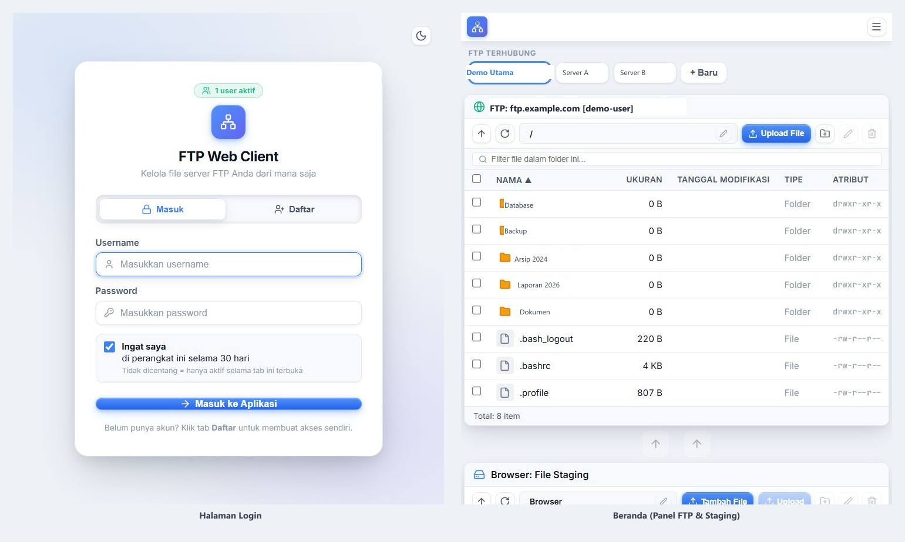

# Web FTP Client — Dual-Pane, Cloud-Ready

Aplikasi **FTP/SFTP dua panel** berbasis web: panel kiri untuk file di perangkat/browser
(staging), panel kanan untuk file di server FTP — drag & drop antar-panel, transfer
dengan progress, tema putih/AMOLED, dan akun multi-pengguna dengan Panel Admin.

## 🚀 Coba Langsung (tanpa install)

**👉 https://web-ftp-client-five.vercel.app**

Buat akun lewat tab **Daftar**, lalu langsung kelola file FTP Anda dari komputer maupun ponsel.

## 📸 Tampilan



## ✨ Fitur

- **Dual-pane file manager** — browse folder FTP & komputer berdampingan; drag & drop, rename, buat folder, hapus, filter, sort
- **Transfer antrian** — upload/download dengan progress bar, pause/reorder/clear antrian
- **Sistem akun** — login, tab **Daftar** (registrasi mandiri, masa aktif default 30 hari),
  **Remember Me** (sesi tersimpan 30 hari), dan **Panel Admin** untuk menambah/menghapus
  akun serta mengatur masa aktif per akun
- **Profil FTP** — koneksi tersimpan per akun dan **tersinkron antar perangkat** lewat
  database bersama di Vercel Blob (privat)
- **User aktif** — jumlah pengguna yang sedang online tampil di halaman login & beranda
- **Responsif** — tampilan desktop & ponsel (burger menu, bar "FTP Terhubung" dengan chip,
  toolbar yang dilipat)
- **Tema** terang (putih) & gelap (AMOLED murni)

## ☁️ Mode

| Mode | Kapan dipakai | Backend |
|------|---------------|---------|
| **Cloud (Vercel)** | Diakses lewat link di atas | Vercel Serverless Functions (`api/`) + Vercel Blob untuk database bersama |
| **Lokal** | Jalan di PC sendiri (`npm run dev`) | Node.js Express + WebSocket di `server/` |

## 🔒 Keamanan

- Password akun disimpan sebagai **SHA-256 + salt** (tidak pernah plaintext)
- Password FTP **tidak pernah** dikirim ke repo/kode dan hanya bisa dibaca oleh akun terautentikasi
- Database bersama tersimpan di **Vercel Blob privat** — hanya bisa diakses lewat token sesi
  (HMAC) dari server aplikasi; akun biasa tidak bisa melihat data akun lain
- `data/profiles.json` (kredensial lokal) di-gitignore dan tidak pernah masuk repo
- Tidak ada API key / secret / kredensial di dalam kode sumber

## 🛠️ Menjalankan versi lokal

```bash
npm install
cd client && npm install && cd ..
npm run dev        # server :5000 + vite :5173
```

## 🚢 Deploy ke Vercel (Anda bisa fork & pakai sendiri)

1. **Fork** repo ini.
2. Buat **Vercel Blob** (`vercel storage create ftp-db --type blob --access private`, lalu
   `vercel storage connect ftp-db`).
3. Di [vercel.com](https://vercel.com): **Add New → Project → Import** repo fork,
   `buildCommand` sudah berisi `cd client && npm run build`, output `client/dist`.
4. Deploy — layar **Setup Awal** muncul otomatis untuk membuat akun admin pertama.

Detail arsitektur, endpoint, dan catatan untuk pengembang berikutnya:
**[CATATAN-SETUP.md](CATATAN-SETUP.md)**

## 🧱 Stack

React + Vite · Node.js/Express · Vercel Serverless Functions · Vercel Blob ·
basic-ftp · ssh2-sftp-client · lucide-react
